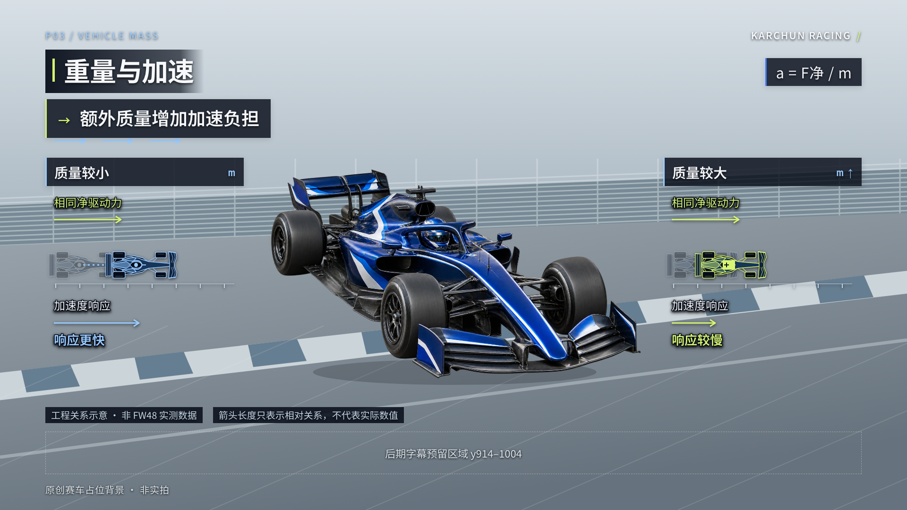

# 视频素材｜P03 赛车重量影响

Karchun Racing 威廉姆斯 2026 横屏视频制作素材。本文件夹保存 F1 赛车造型修订后的最新版，包含七条完整成片、F1 赛车示意原图、可复用工程源码、使用说明及完整性检查。

全部成片为 **1920×1080、16:9、30fps，无配音与音乐**。本次仅 P03；预览中的赛车为生成的通用 F1 示意车，非真实比赛录像，非 FW48 精确模型。两侧技术图形和赛车俯视示意为 SVG。



## 七条成片

| 内容 | 透明叠加素材 | 查看预览 | 时长 |
| --- | --- | --- | --- |
| 加速 | [P03_A_Acceleration.mov](成片/P03_A_Acceleration.mov) | [P03_A_Preview.mp4](成片/P03_A_Preview.mp4) | 7 秒 |
| 制动 | [P03_B_Braking.mov](成片/P03_B_Braking.mov) | [P03_B_Preview.mp4](成片/P03_B_Preview.mp4) | 7 秒 |
| 过弯 | [P03_C_Cornering.mov](成片/P03_C_Cornering.mov) | [P03_C_Preview.mp4](成片/P03_C_Preview.mp4) | 8 秒 |
| 连续演示 | — | [P03_Combined_Demo.mp4](成片/P03_Combined_Demo.mp4) | 22 秒 |

MOV 为 **Apple ProRes 4444，保留真实 Alpha**。MP4 带中性占位背景，只用于看片。剪映中将 MOV 放在实拍比赛视频上方，默认合成、100% 不透明度，字幕另放在 y914–1004。无需对 MOV 抠黑或使用滤色。

## 赛车素材和工程

- [F1 赛车示意原图 PNG](F1赛车示意原图.png)：透明背景，仅用于预览底片。
- [赛车素材生成说明](赛车素材生成说明.md)：内置 imagegen 生成方式及原图限制。
- [P03 工程源码 ZIP](P03_工程源码.zip)：含 Remotion、React、TypeScript、SVG 源码及新车资产，解压后按说明安装锁定依赖。
- [完整制作与使用说明](P03_制作与使用说明.md)。
- [媒体和透明通道检查](P03_媒体与透明通道检查.json)。
- [七条成片 SHA-256 校验](成片完整性校验.json)。

## 在另一台电脑下载

较大的透明 MOV 使用 Git LFS 存储，保持原文件和原画质。网页中进入对应 MOV 后使用下载原文件按钮；克隆仓库时先安装 Git LFS：

```bash
git lfs install
git clone https://github.com/wujiajunapower-tech/williams-fw48-3d.git
cd williams-fw48-3d
git lfs pull
```

如本机已有仓库，执行 `git pull` 和 `git lfs pull` 即可。普通 Download ZIP 的 LFS 包含情况取决于仓库设置，下载后请核对 MOV 不是短小的指针文本。七条原文件的大小和 SHA-256 在校验文件中，可以确认下载完整。

透明区域、首尾退出和画面留白已验证；实际镜头由创作者在剪映中添加，动画不自动追踪赛车。未扩展 G03。
